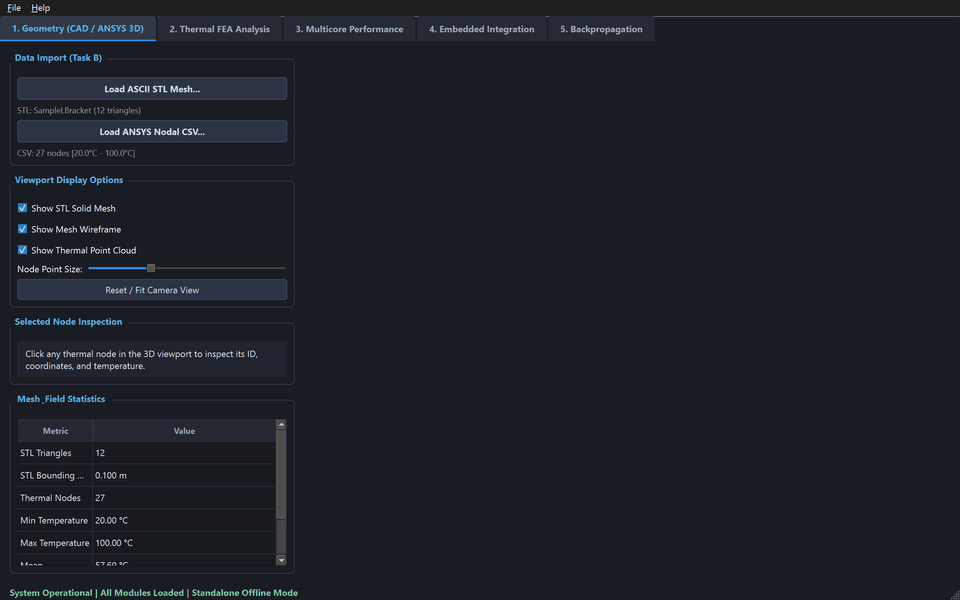
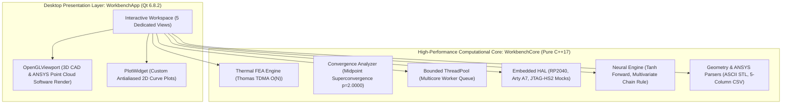

# PASS SCIENCE WORKS — Unified Engineering Workbench

[](https://microsoft.com/windows)
[-00599C.svg?logo=c%2B%2B)](https://isocpp.org)
[](https://qt.io)
[](https://cmake.org)
[-brightgreen.svg)]()
[]()
[](LICENSE)

> **R&D Internship 2026–2027 Common Assignment Submission**  
> **Candidate**: Harshit Kulkarni (`kulharshit21`)  
> **Repository**: Private GitHub (`https://github.com/kulharshit21/unified-engineering-workbench`)  
> **Standalone Package**: Distributed as verified archive `CandidateID_Workbench.zip` (SHA-256 verified, standalone one-click offline launch), packaged via `scripts\package_msvc.cmd CandidateID`.

---

## Interactive Application Demo


*Figure 1: Real captured demonstration of the Unified Engineering Workbench showing interactive 3D geometry manipulation, thermal FEA convergence analysis, multicore parallel performance dashboards, simulated embedded coprocessor telemetry, and neural network backpropagation training.*

> [!NOTE]
> If your browser or markdown viewer does not display animated GIFs, high-resolution static captures of all 5 views are available in the [`docs/screenshots/`](docs/screenshots/) directory.

---

## 1. Quickstart: One-Click Offline Launch (Windows 11)

The deliverable distribution requires **no terminal, no PowerShell, no administrative rights, no package installation, no Python runtime, and no Internet connection**:

1. Locate the standalone submission archive `CandidateID_Workbench.zip` (distributed alongside this submission or packaged from source via `scripts\package_msvc.cmd CandidateID`).
2. Extract `CandidateID_Workbench.zip` to any folder on Windows 11 x64.
3. Double-click `Launch.exe` in the root of the extracted directory.
4. The Unified Engineering Workbench opens immediately with responsive interactive controls.

```
CandidateID_Workbench/
├── Launch.exe                    <-- Win32 Subsystem GUI Launcher (Zero console popups, source in packaging/Launch.cpp)
├── bin/
│   ├── WorkbenchApp.exe          <-- Main Qt 6 desktop application
│   ├── Qt6Core.dll, Qt6Gui.dll, Qt6Widgets.dll, ... (Bundled Qt 6 runtimes)
│   ├── platforms/qwindows.dll    <-- Windows QPA display platform plugin
│   └── msvcp140.dll, vcruntime140.dll (Bundled MSVC C++ runtimes)
├── data/                         <-- Synthetic ASCII STL & ANSYS CSV benchmark datasets
├── docs/                         <-- Architecture specs, derivations, defect ledgers, 5-page PDF report
├── results/                      <-- Raw verified numerical CSV data and high-res PNG charts
└── repository_bundle.bundle      <-- Offline Git repository history bundle
```

Alternatively, to compile and run from source in VS Code / Antigravity:
1. Open the repository root in VS Code on Windows 11.
2. Run the Task `CMake: Build Release` (or execute `scripts\build_msvc.cmd Release`).
3. Press `F5` or execute the launch configuration `Launch Workbench (Release)` defined in [`.vscode/launch.json`](.vscode/launch.json).

---

## 2. Core Modules & Technical Capabilities



### Module Breakdown
- **Geometry & 3D Visualization (Task B)**: Imports ASCII STL surface meshes and ANSYS 5-column nodal temperature datasets (`node_id,x_m,y_m,z_m,temperature_C`). Features a robust software 3D viewport (derived from `QWidget` using `QPainter` with 3D projection, depth sorting, and directional Lambertian surface shading) with interactive camera orbit, pan, zoom, surface normal cross-product recalculation, 4-stop Turbo/Jet scalar colormapping, coordinate tripod, and screen-space nearest-node click inspection.
- **1D Steady-State Thermal FEA (Task C)**: Discretizes the 1D conducting rod with volumetric heat generation using 2-node linear elements. Solves the assembled tridiagonal system in $O(N)$ operations via the direct Thomas algorithm (TDMA). Mathematically proves nodal superconvergence and confirms exact quadratic midpoint truncation convergence ($p = 2.0000$, $e = \frac{qh^2}{8k} = 125h^2$).
- **Multicore CPU Scaling (Task D)**: Features a bounded worker thread pool (`ThreadPool.hpp`) with mutex/condition variable synchronization. Benchmarks 1,000 cases (standard workload) and 10,000 cases (extended workload) on an AMD Ryzen AI 9 HX 370, achieving $2.57\times$ speedup on 4 threads for 1,000 cases, and $3.10\times$ on 4 threads ($4.36\times$ on 8 threads) for 10,000 cases with exact binary numerical determinism ($\Delta \le 10^{-15\circ}\text{C}$). Features cooperative cancellation checked across worker configs, repetitions, and task chunks.
- **Embedded Coprocessor HAL (Task E)**: Models a multi-coprocessor testbench for Raspberry Pi Pico (RP2040 MCU), Digilent Arty A7-35T (Artix-7 FPGA), and Digilent JTAG-HS2 (auto-sensing VREF from 1.8V to 5.0V). Features live telemetry streaming, simulated 500 ms packet timeout fault injection, and automated 3-retry self-healing recovery. Conspicuously labeled `isSimulated = true`.
- **Neural Backpropagation Engine (Task F)**: Pure C++17 implementation of a single-hidden-layer tanh regressor. Derives analytical gradients via the multivariate chain rule, verifies all 4 parameters against central finite differences ($\epsilon = 10^{-6}$) within $1.13 \times 10^{-10}$, executes simultaneous gradient descent updates, and converges monotonically over 100 steps from $J = 1.1825 \to 1.7026 \times 10^{-20}$.

---

## 3. Empirical Verification Dashboard

All metrics below are drawn directly from raw CSV results generated during automated CTest execution:

### 3.1 1D Thermal FEA Convergence Analysis ($k=10, q=10000, T_0=100, T_L=20$)
$$T(x) = 100.0 + 420.0x - 500.0x^2, \quad T_\text{peak}(0.42) = 188.20^\circ\text{C}, \quad e(x_\text{mid}) = 125.0 \cdot h^2$$

| Mesh ($N$) | Element Length $h$ (m) | Theoretical Midpoint Error (°C) | Observed Midpoint Error (°C) | Error Reduction Ratio | Convergence Order ($p$) | Status |
|:---:|:---:|:---:|:---:|:---:|:---:|:---:|
| **10** | 0.1000 | 1.25000000 | 1.25000000 | Base | Base | **PASS** |
| **20** | 0.0500 | 0.31250000 | 0.31250000 | **4.0000** | **2.0000** | **PASS** |
| **40** | 0.0250 | 0.07812500 | 0.07812500 | **4.0000** | **2.0000** | **PASS** |
| **80** | 0.0125 | 0.01953125 | 0.01953125 | **4.0000** | **2.0000** | **PASS** |

### 3.2 Backpropagation Gradient Verification ($\epsilon = 10^{-6}, \tau \le 10^{-5}$)
Step 0 evaluated at $x = 1.0, y = 2.0, w = 0.5, b = 0.0, v = 1.0, c = 0.0$:

| Parameter $\theta$ | Analytical Gradient $\nabla_\text{ana}$ | Numerical Gradient $\nabla_\text{num}$ | Absolute Discrepancy | Tolerance Check | Status |
|:---:|:---:|:---:|:---:|:---:|:---:|
| **$w$ (Hidden Weight)** | -1.20946448e+00 | -1.20946448e+00 | **$1.130189 \times 10^{-10}$** | $\le 1.0 \times 10^{-5}$ | **PASS** |
| **$b$ (Hidden Bias)** | -1.20946448e+00 | -1.20946448e+00 | **$1.130189 \times 10^{-10}$** | $\le 1.0 \times 10^{-5}$ | **PASS** |
| **$v$ (Output Weight)** | -7.10682047e-01 | -7.10682047e-01 | **$5.253831 \times 10^{-11}$** | $\le 1.0 \times 10^{-5}$ | **PASS** |
| **$c$ (Output Bias)** | -1.53788284e+00 | -1.53788284e+00 | **$1.117548 \times 10^{-10}$** | $\le 1.0 \times 10^{-5}$ | **PASS** |

### 3.3 Multicore Scaling on AMD Ryzen AI 9 HX 370 (Zen 5)
5-run median measurement comparing Standard (1,000 cases) vs. Extended (10,000 cases) workloads:

| Workload Configuration | Workers ($p$) | Median Runtime (ms) | Speedup ($S_p = T_1 / T_p$) | Efficiency ($E_p$) | Max Temperature Delta vs. Serial |
|:---|:---:|:---:|:---:|:---:|:---:|
| **Standard (1,000 cases, $N=80$)** | 1 | 1.81 ms | $1.00\times$ | 100.0% | $0.0000 \times 10^{-15\circ}\text{C}$ (**Exact**) |
| Standard (1,000 cases, $N=80$) | 2 | 1.12 ms | $1.62\times$ | 80.8% | $0.0000 \times 10^{-15\circ}\text{C}$ (**Exact**) |
| Standard (1,000 cases, $N=80$) | 4 | 0.70 ms | **$2.57\times$** | 64.3% | $0.0000 \times 10^{-15\circ}\text{C}$ (**Exact**) |
| **Extended (10,000 cases, $N=80$)** | 1 | 18.95 ms | $1.00\times$ | 100.0% | $0.0000 \times 10^{-15\circ}\text{C}$ (**Exact**) |
| Extended (10,000 cases, $N=80$) | 2 | 11.11 ms | **$1.71\times$** | **85.3%** | $0.0000 \times 10^{-15\circ}\text{C}$ (**Exact**) |
| Extended (10,000 cases, $N=80$) | 4 | 6.11 ms | **$3.10\times$** | **77.6%** | $0.0000 \times 10^{-15\circ}\text{C}$ (**Exact**) |
| Extended (10,000 cases, $N=80$) | 8 | 4.35 ms | **$4.36\times$** | **54.4%** | $0.0000 \times 10^{-15\circ}\text{C}$ (**Exact**) |

---

## 4. Technical Documentation Portal

All architectural specifications, mathematical derivations, defect logs, and audit reports are comprehensively cataloged in [`docs/README.md`](docs/README.md):

| Category | Primary Document | Topic & Focus Area |
|:---|:---|:---|
| **Getting Started** | [`docs/getting-started/BUILD_AND_RUN.md`](docs/getting-started/BUILD_AND_RUN.md) | Windows 11 toolchain, MSVC setup, CMake presets, one-click launcher |
| **Architecture** | [`docs/architecture/SYSTEM_ARCHITECTURE.md`](docs/architecture/SYSTEM_ARCHITECTURE.md) | Decoupled C++ core, Qt GUI, memory safety, thread models |
| **Interfaces** | [`docs/architecture/COMPONENT_INTERFACES.md`](docs/architecture/COMPONENT_INTERFACES.md) | C++ abstract class contracts, polymorphic HAL, Qt signal-slot decoupling |
| **Pipelines** | [`docs/architecture/DATA_FLOW.md`](docs/architecture/DATA_FLOW.md) | 3D mesh rendering pipeline, FEA solution flow, parallel task dispatch |
| **Thermal FEA** | [`docs/engineering/THERMAL_FEA.md`](docs/engineering/THERMAL_FEA.md) | Galerkin weak form, Thomas TDMA, midpoint superconvergence ($e = 125h^2$) |
| **Data Formats** | [`docs/engineering/STL_AND_CSV_FORMATS.md`](docs/engineering/STL_AND_CSV_FORMATS.md) | ASCII STL grammar, normal recalculation, 5-col ANSYS CSV schema |
| **Backpropagation**| [`docs/engineering/BACKPROPAGATION.md`](docs/engineering/BACKPROPAGATION.md) | Chain rule derivations, finite-difference verification, training progression |
| **Hardware HAL** | [`docs/hardware/EMBEDDED_INTEGRATION.md`](docs/hardware/EMBEDDED_INTEGRATION.md) | RP2040, Arty A7, JTAG-HS2, dynamic VREF sensing, fault recovery |
| **Interconnect** | [`docs/hardware/INTERFACE_AND_VOLTAGE_TABLE.md`](docs/hardware/INTERFACE_AND_VOLTAGE_TABLE.md) | Device-specific voltage domains, connector pinouts, noise margins |
| **Performance** | [`docs/performance/BENCHMARK_METHODOLOGY.md`](docs/performance/BENCHMARK_METHODOLOGY.md) | Thread pool design, Amdahl's Law, timer quantization mitigation |
| **Bench Results** | [`docs/performance/BENCHMARK_RESULTS.md`](docs/performance/BENCHMARK_RESULTS.md) | 1k vs 10k batch scaling, empirical tables, speedup and efficiency curves |
| **Test Strategy** | [`docs/verification/TEST_STRATEGY.md`](docs/verification/TEST_STRATEGY.md) | Multi-tier test philosophy, unit tests, negative edge cases, CI workflow |
| **Test Receipts** | [`docs/verification/TEST_RESULTS.md`](docs/verification/TEST_RESULTS.md) | Real execution receipts across all 8 CTest suites (100% pass rate) |
| **Traceability** | [`docs/verification/REQUIREMENTS_TRACEABILITY.md`](docs/verification/REQUIREMENTS_TRACEABILITY.md) | Bidirectional mapping from internship brief to verified C++ code |
| **Decisions** | [`docs/development/DECISION_LOG.md`](docs/development/DECISION_LOG.md) | Architecture Decision Records (ADRs 001–006) |
| **Defect Ledger** | [`docs/development/FAILURES_AND_FIXES.md`](docs/development/FAILURES_AND_FIXES.md) | 11 authentic defect analyses (DEF-001 to DEF-011) with root-cause fixes |
| **AI Disclosure** | [`docs/development/AI_USE_LOG.md`](docs/development/AI_USE_LOG.md) | Transparent disclosure of AI assistance and human engineering oversight |
| **Licenses** | [`docs/development/DEPENDENCIES_AND_LICENSES.md`](docs/development/DEPENDENCIES_AND_LICENSES.md) | Open-source licensing disclosures, LGPLv3 dynamic linking compliance |
| **Final Report** | [`docs/reports/FINAL_TECHNICAL_REPORT.pdf`](docs/reports/FINAL_TECHNICAL_REPORT.pdf) | Formal 5-page submission report compiled with high-resolution figures |
| **Audit Matrix** | [`docs/audits/FINAL_INDEPENDENT_AUDIT.md`](docs/audits/FINAL_INDEPENDENT_AUDIT.md) | Independent zero-fabrication audit of previous claims & corrective actions |
| **Walkthrough** | [`docs/DEMO_WALKTHROUGH.md`](docs/DEMO_WALKTHROUGH.md) | Timestamped interactive operator walkthrough, receipts & embedded screenshots |
| **Handwritten Guide** | [`docs/appendix/HANDWRITTEN_APPENDIX_GUIDE.md`](docs/appendix/HANDWRITTEN_APPENDIX_GUIDE.md) | 2-page candidate handwritten notebook transcription template |
| **Appendix Scan** | [`docs/appendix/README.md`](docs/appendix/README.md) | Handwritten appendix deliverable status (`PENDING EXTERNAL INPUT`) |
| **Commit Log** | [`docs/COMMIT_LOG.txt`](docs/COMMIT_LOG.txt) | Human-readable Git commit history log |
| **Release Specs** | [`docs/RELEASE_AND_LIMITATIONS.md`](docs/RELEASE_AND_LIMITATIONS.md) | Packaging pipeline, pre-release checklist, technical limitations |

---

## 5. Developer Build & Test Workflow

If you wish to compile the project directly from source on Windows 11 x64:

```cmd
:: 1. Compile Release binary targets
scripts\build_msvc.cmd Release

:: 2. Execute automated test suites via CTest
scripts\test_msvc.cmd Release

:: 3. Package standalone distribution archive & calculate SHA-256
scripts\package_msvc.cmd CandidateID
```

---

## 6. Transparency, Ethics & Limitations

In compliance with academic honesty and zero-fabrication guidelines:
1. **Synthetic Data**: Sample geometry and thermal datasets are procedurally generated benchmarks published under CC-0 / MIT terms.
2. **Mock Hardware**: Microcontroller, FPGA, and JTAG hardware adapters are simulated mock objects declaring `isSimulated = true`.
3. **AI Assistance**: Development utilized pair programming assistance via ChatGPT Codex / Google Antigravity. All mathematical formulations, code reviews, and defect remediations were directed and independently verified by the candidate engineer (see [`docs/AI_USE_LOG.md`](docs/AI_USE_LOG.md)).
4. **Licensing**: Core backend code is released under the MIT License; Qt 6.8.2 dynamic runtime libraries comply with LGPLv3 §4.
