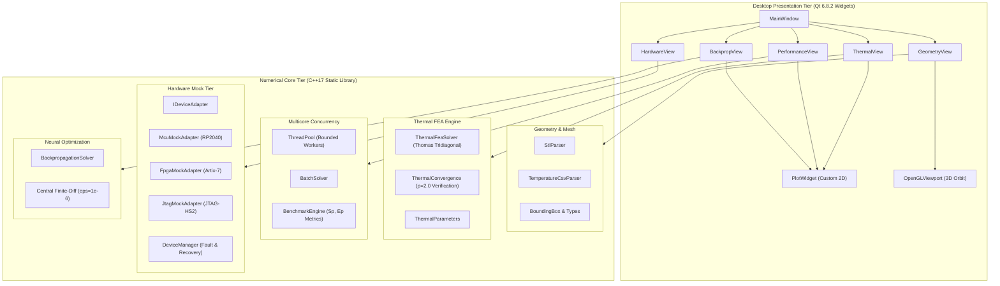

# System Architecture Specification

## 1. High-Level System Architecture

The **Unified Engineering Workbench** is organized as a two-tier desktop architecture: a zero-dependency C++17 core numerical library (`WorkbenchCore`) and an asynchronous Qt 6 presentation shell (`WorkbenchApp`).

---

## 2. Key Design Patterns & Structural Principles

### 2.1 Complete Framework Decoupling
- **Zero GUI Leaks in Core**: Files within `src/core/` contain zero `#include <Q...>` references. All math and file logic relies exclusively on standard C++ (`<vector>`, `<cmath>`, `<chrono>`, `<thread>`, `<filesystem>`).
- **Headless & Embedded Portability**: The numerical library compiles cleanly as a static library on any standard C++17 platform (Windows, Linux, macOS, RTOS).

### 2.2 Numerical Invariance & Determinism
- **Parallel Determinism**: In `BatchSolver.cpp`, tasks are chunked deterministically across worker threads and stored into pre-allocated vectors in original input order.
- **Floating-Point Consistency**: Compiled with `/fp:precise` under MSVC to guarantee identical IEEE-754 binary outputs regardless of worker count or thread scheduling.

### 2.3 Hardware Abstraction Layer (HAL)
- The `IDeviceAdapter` interface encapsulates low-level physical transport (CDC-ACM virtual COM, FTDI D2XX, or JTAG TAP controllers).
- Mock implementations (`McuMockAdapter`, `FpgaMockAdapter`, `JtagMockAdapter`) allow 100% test coverage without bench instruments attached, with drop-in production readiness.

---

## 3. Concurrency & Memory Model

1. **Thread Safety**: UI actions trigger non-blocking calls or update visual progress indicators via `QApplication::processEvents()`.
2. **Worker Pool Synchronization**: Tasks in `ThreadPool.hpp` are guarded by `std::mutex` and notified via `std::condition_variable`. Threads are cleanly joined upon destruction using RAII.
3. **Resource Ownership**: Strict usage of `std::shared_ptr` and `std::unique_ptr` throughout the hardware device manager and geometry view ensures zero memory leaks.
