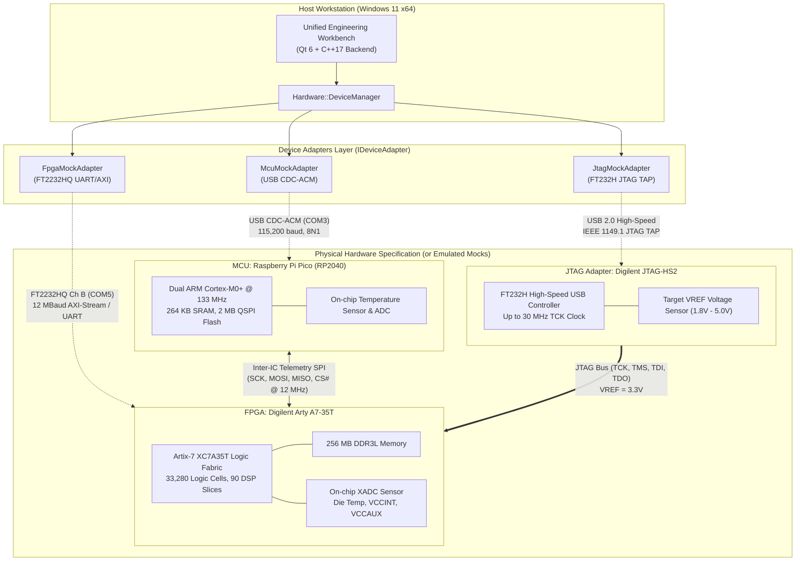

# Embedded System Integration Architecture (Task E)

## 1. Overview and System Topology

The **Unified Engineering Workbench** interfaces with a heterogeneous embedded architecture comprising:
1. **Host Workstation**: Running the Unified Engineering Workbench (Windows 11 x64).
2. **Microcontroller Unit (MCU)**: **Raspberry Pi Pico** (Dual-core ARM Cortex-M0+ RP2040 @ 133 MHz).
3. **Field-Programmable Gate Array (FPGA)**: **Digilent Arty A7-35T** (AMD/Xilinx Artix-7 XC7A35T-1CPG236C).
4. **JTAG Debug Adapter**: **Digilent JTAG-HS2** (High-Speed FTDI FT232H-based JTAG/SPI probe).

This configuration models an edge-compute coprocessor system where the MCU serves as an auxiliary telemetry acquisition and power sequencer node, the FPGA serves as a high-throughput hardware accelerator (e.g. accelerating numerical matrix operations or digital signal processing), and the JTAG adapter provides hardware configuration and non-intrusive runtime debugging.



---

## 2. Signal Interconnect and Communication Protocols

### 2.1 Host-to-MCU Interface
- **Physical Transport**: USB 1.1 Full Speed (12 Mbps) via Micro-USB connector.
- **Protocol**: USB CDC-ACM Virtual COM port (`COM3` default).
- **Packet Structure**: Binary packet framing with 2-byte sync header (`0xAA 0x55`), 1-byte command ID, 1-byte length, $N$-byte payload, and CRC-16-CCITT checksum.
- **Buffer Depth**: 512 bytes dual-buffered ring buffer in RP2040 SRAM.
- **Telemetry Query**: Host requests diagnostic packets at 10 Hz; response includes internal ADC temperature (°C), $V_{DD}$ rail (3.3V), and packet counter.

### 2.2 Host-to-FPGA Interface
- **Physical Transport**: Dedicated high-speed UART via FTDI FT2232HQ Channel B.
- **Protocol**: AXI4-Lite command transactions encapsulated over framed serial protocol operating at up to 12 Mbaud.
- **Telemetry Source**: Xilinx internal XADC primitive continuously digitizing die temperature, $V_\text{CCINT}$ (1.0V), and $V_\text{CCAUX}$ (1.8V).
- **Buffer Depth**: 4 KB FIFO in FTDI chip + 16 KB BRAM FIFO in Artix-7 fabric.

### 2.3 JTAG Debug Interface
- **Physical Transport**: Digilent JTAG-HS2 High-Speed USB 2.0 (480 Mbps).
- **Target Interface**: 6-pin 100-mil standard JTAG header matching Digilent pinout (`VREF`, `TMS`, `TCK`, `TDO`, `TDI`, `GND`).
- **Clock Rate**: Programmable from 30 kHz to 30 MHz.
- **Capabilities**: Full IEEE 1149.1 boundary scan, Artix-7 bitstream programming, and internal MicroBlaze / core debugging via Xilinx BSCANE2 primitives.

---

## 3. Power, Grounding, and Reset Topology

```
                  +----------------------------------------------+
                  |              Host 5V USB Bus                 |
                  +-------+--------------------+-----------------+
                          |                    |
                          v                    v
                   +--------------+     +--------------+
                   |  Pico USB    |     |  Arty USB    |
                   |  5V -> 3.3V  |     |  5V -> LDOs  |
                   | (RT6150 B/B) |     | (ADP2118 SW) |
                   +------+-------+     +------+-------+
                          |                    |
              +-----------+                    +---------------+
              | 3.3V Rail                      | 3.3V, 1.8V, 1.0V
              v                                v
       [ Raspberry Pi Pico ]            [ Artix-7 FPGA ]
              |                                |
              +-------- COMMON GND ------------+
              |                                |
              +---- Active-Low Reset (NRST) ---+
```

1. **Common Ground Star Topology**: All grounds (Host PC ground, Pico GND pins 3/8/13/18/23/28/38, Arty GND headers, and JTAG-HS2 pin 2) are tied together to prevent ground loops and signal integrity degradation.
2. **Reset Coordination**:
   - Master hardware reset can be asserted by the Host through the JTAG interface (SRST) or programmatically by the RP2040 via a designated open-drain GPIO line with a 10 kΩ pull-up to 3.3V.
   - Power-on Reset (POR) sequencing ensures the FPGA core rail ($V_\text{CCINT} = 1.0\text{ V}$) stabilizes before auxiliary ($V_\text{CCAUX} = 1.8\text{ V}$) and I/O ($V_\text{CCO} = 3.3\text{ V}$) rails ramp.

---

## 4. Software Abstraction: The `IDeviceAdapter` Pattern

To decouple the desktop user interface and numerical solvers from physical hardware dependencies:
- All physical devices and mock models implement `IDeviceAdapter`.
- `DeviceManager` acts as the single point of coordination, handling device registration, asynchronous or synchronous telemetry queries, error detection, timeout handling, and automatic recovery sequences.
- When running in an environment without physical laboratory hardware attached, the software transparently utilizes validated mock adapters (`McuMockAdapter`, `FpgaMockAdapter`, `JtagMockAdapter`).
- **Zero-Fabrication Disclosure**: All mock adapters explicitly report `isSimulated = true` via `getInfo().isSimulated`, clearly visible in the UI and diagnostic logs.
