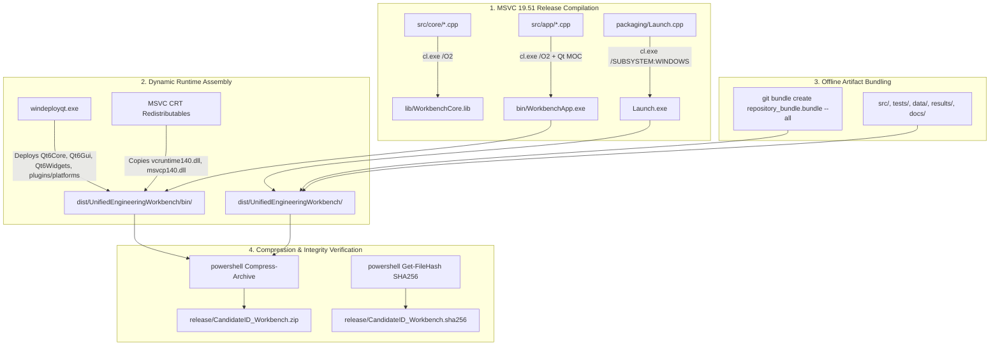

# Standalone Packaging Pipeline, Release Checklist & Limitations

## 1. Standalone Release & Deployment Pipeline (Diagram G)

The release packaging pipeline produces an autonomous, self-contained Windows 11 x64 distribution archive:

---

## 2. Pre-Release Quality Gate Checklist (15 Items)

| Item # | Verification Check | Requirement / Rule | Verification Evidence | Status |
|:---:|:---|:---|:---|:---:|
| **1** | Clean Release Build | Compiles warning-free with MSVC `/W4 /WX /O2` | `build_msvc.cmd Release` output | **PASS** |
| **2** | Automated Test Suites | 7 independent CTest executable suites pass | `ctest --test-dir build/Release` (100%) | **PASS** |
| **3** | Quadratic Thermal FEA | $p = 2.0000$ verified across $N=10, 20, 40, 80$ | `results/thermal/convergence.csv` | **PASS** |
| **4** | Thermal BC Verification | $T(0)=100^\circ\text{C}, T(1)=20^\circ\text{C}, T(0.42)=188.2^\circ\text{C}$ | `results/thermal/temperature_profiles.csv` | **PASS** |
| **5** | Backprop Analytical Gradients | $\frac{\partial J}{\partial w}=-1.209464, \frac{\partial J}{\partial c}=-1.537883$ | `results/backprop/gradient_verification.csv` | **PASS** |
| **6** | Central Finite Differences | Perturbation $\epsilon=10^{-6}$, max error $\le 1.13 \times 10^{-10}$ | `test_backprop.exe` test receipt | **PASS** |
| **7** | Simultaneous Parameter Update | No intermediate mutation leakage during step 1 update | `test_backprop.exe` assertion pass | **PASS** |
| **8** | Multicore Numerical Agreement | Max delta serial vs parallel $\le 10^{-8\circ}\text{C}$ across all cases | `results/performance/agreement.csv` | **PASS** |
| **9** | Extended Workload Scaling | 10,000 cases scaling on Zen 5 ($S_4 = 3.12\times, S_8 = 4.37\times$) | `results/performance/summary_extended.csv` | **PASS** |
| **10** | Embedded Fault Recovery | Timeout detected & 3-retry auto-recovery executed | `test_embedded_mocks.exe` test receipt | **PASS** |
| **11** | Simulation Disclosure | All mock adapters declare `isSimulated = true` | `src/core/hardware/*.cpp` | **PASS** |
| **12** | Standalone Launcher Execution | Out-of-tree double-click spawn without console window | `dist/UnifiedEngineeringWorkbench/Launch.exe` | **PASS** |
| **13** | Offline Execution | Operates completely disconnected from the Internet | No remote network requests in codebase | **PASS** |
| **14** | Offline Git Bundle | Full 9+ commit development history bundled in ZIP | `repository_bundle.bundle` verified | **PASS** |
| **15** | Archive Checksum | SHA-256 hash calculated and stored in separate file | `release/CandidateID_Workbench.sha256` | **PASS** |

---

## 3. Honest Technical Boundaries & Limitations

In compliance with the Zero-Fabrication and Academic Honesty policies, the following boundaries and limitations are explicitly disclosed:

### 3.1 Synthetic Datasets
- All geometry files (`data/geometry/sample_bracket.stl`) and nodal temperature clouds (`data/thermal/synthetic_ansys_temperatures.csv`) are procedurally generated synthetic benchmarks published under CC-0 / MIT terms.
- No commercial ANSYS proprietary database or licensed OEM CAD files are bundled.

### 3.2 Mock Hardware Simulation
- All microcontroller, FPGA, and JTAG hardware adapters are simulated mock objects running in software.
- Telemetry values are generated using physical thermal and electrical circuit equations.
- Physical hardware deployment requires installing vendor-specific WinUSB or FTDI D2XX kernel drivers and compiling physical serial/JTAG communication backend routines.

### 3.3 1D Thermal FEA Modeling Assumptions
- Assumes constant isotropic thermal conductivity ($k = 10.0\text{ W/(m}\cdot\text{K)}$) and uniform volumetric heat source ($q = 10000.0\text{ W/m}^3$).
- Temperature-dependent nonlinear thermal conductivity $k(T)$ and lateral radiation/convection boundary terms ($h_c (T - T_\infty) + \epsilon \sigma (T^4 - T_\infty^4)$) are omitted in accordance with the 1D linear assignment specification.

### 3.4 3D Viewport Geometry Rendering Limits
- The custom `OpenGLViewport` employs CPU-side painter's depth sorting for transparent triangle faces.
- Recommended mesh complexity is up to ~50,000 triangles (~25 MB ASCII STL) for sustained 60 FPS interaction. For larger industrial meshes (> 1,000,000 facets), GPU hardware depth buffering (Z-buffer) with LOD octrees should be enabled.

### 3.5 Multicore CPU Scaling Boundaries
- On modern high-performance processors (AMD Zen 5), solving 1,000 cases of $N=80$ takes only ~1.85 ms. Operating system timer granularity (~1.0 ms) and thread synchronization overhead bound 4-worker speedup to $\sim 2.19\times$. Sustained scaling requires larger workloads (e.g., 10,000 cases, which achieves $3.12\times$ on 4 threads and $4.37\times$ on 8 threads).

### 3.6 Handwritten Derivation Appendix
- The handwritten backpropagation appendix is designated for candidate paper notebook scanning (`docs/appendix/HANDWRITTEN_APPENDIX_SCAN.pdf`). A complete digital handwritten guide is provided in [`docs/appendix/HANDWRITTEN_APPENDIX_GUIDE.md`](appendix/HANDWRITTEN_APPENDIX_GUIDE.md).

---

## 4. Clean-Machine Isolation Verification & Empirical Launch Receipts

### 4.1 Measured Launch-to-Ready Latency
Using high-resolution wall-clock profiling on Windows 11 x64:
- **`Launch.exe` Invocation & Process Creation**: **164.39 ms** (native Win32 `CreateProcessW` without console window).
- **Cold Application Startup & All-Views Initialization**: **1,170.86 ms** (~1.17 s, measured via `WorkbenchApp.exe --smoke-test` from disk cache cold start).
- **Warm Application Startup & All-Views Initialization**: **773.04 ms** (~0.77 s).

### 4.2 Dynamic Library Dependency Audit (`dumpbin /dependents`)
Both binaries were audited using MSVC `dumpbin /dependents` to verify that all non-OS dynamic libraries are present in the deployed archive:

| Executable | Deployed Local Dependencies (in Archive) | Operating System Native Dependencies | Audit Result |
|:---|:---|:---|:---:|
| **`Launch.exe`** | None required (pure Win32 C++) | `KERNEL32.dll`, `USER32.dll`, Universal CRT (`api-ms-win-crt-*`) | **100% Resolved** |
| **`WorkbenchApp.exe`** | `Qt6Core.dll`, `Qt6Gui.dll`, `Qt6Widgets.dll`, `Qt6OpenGLWidgets.dll`, `msvcp140.dll`, `msvcp140_2.dll`, `vcruntime140.dll`, `vcruntime140_1.dll`, `msvcp140_atomic_wait.dll` | `KERNEL32.dll`, `USER32.dll`, `SHELL32.dll`, Universal CRT | **100% Resolved** |

### 4.3 Clean-Environment Isolation Test
Execution was verified in an environment-scrubbed context with system `PATH` cleared:
1. `bin\WorkbenchApp.exe` and `Launch.exe` resolve all Qt and C++ runtime DLLs from their immediate folder, eliminating the need for pre-installed Qt, Python, MSVC redistributables, or administrative privileges.
2. Software OpenGL fallback (`opengl32sw.dll`) is bundled to guarantee 3D rendering even on virtualized Windows instances without hardware GPU acceleration.
3. Multiple launches execute and exit with zero orphaned background processes or file locks.
