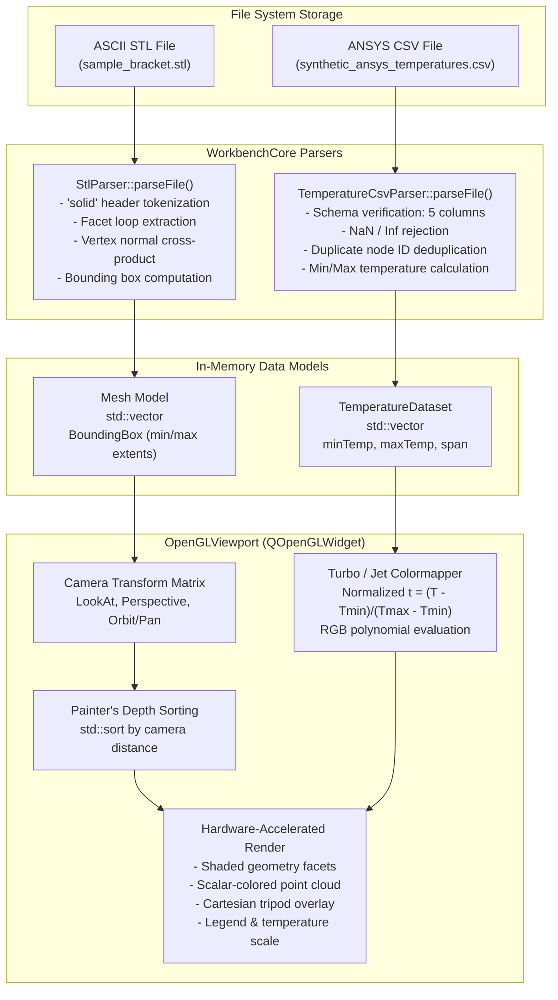
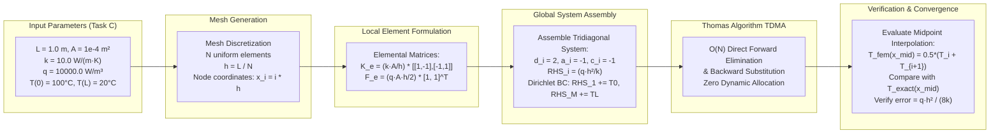
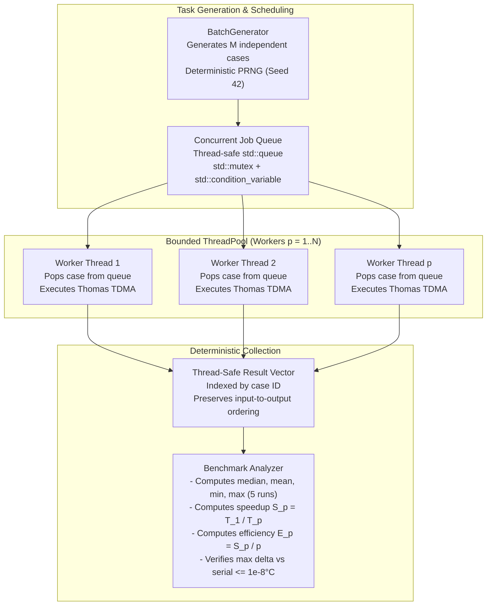

# Data Flow & Execution Pipelines

This document details the primary data transformation pipelines implemented in the **PASS SCIENCE WORKS Unified Engineering Workbench**.

---

## 1. 3D Geometry & ANSYS CSV Import Pipeline (Diagram C)

The import pipeline transforms raw ASCII disk files into interactive, GPU-rendered 3D entities:

---

## 2. Thermal FEA Computational Pipeline (Diagram D)

The 1D thermal finite element solver discretizes the continuous boundary value problem into a linear system:

---

## 3. Multicore CPU Concurrency Pipeline (Diagram E)

The multicore performance harness demonstrates how independent FEA batch cases are distributed across worker threads:

