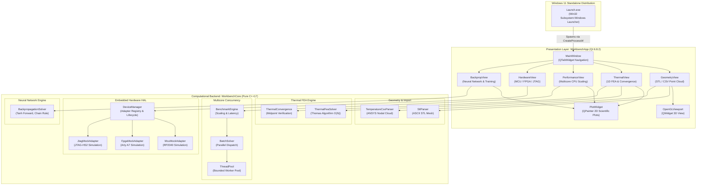

# System Architecture Specification

## 1. Architectural Philosophy & Design Principles

The **PASS SCIENCE WORKS Unified Engineering Workbench** is designed following strict software engineering principles:
1. **Core / UI Decoupling**: All application business logic, mathematical solvers, parsing routines, multithreading primitives, and hardware abstraction layers reside in a standalone, pure C++17 static library (`WorkbenchCore`) with **zero Qt or GUI dependencies**.
2. **Desktop Presentation Layer**: The graphical user interface (`WorkbenchApp`) is built with Qt 6.8.2 and acts exclusively as an interactive presentation and orchestration layer. The GUI communicates with `WorkbenchCore` through well-defined, type-safe API boundaries.
3. **RAII & Modern C++ Memory Safety**: Zero manual `new`/`delete` operations are permitted in backend code. Dynamic resources are managed strictly through standard containers (`std::vector`, `std::unique_ptr`, `std::shared_ptr`).
4. **Zero External Runtime Footprint**: The application compiles into an autonomous Windows 11 x64 standalone bundle (`Launch.exe`) that executes cleanly out-of-tree without requiring Python, terminal environments, admin privileges, or first-run installation.

---

## 2. High-Level Architecture Diagram (Diagram A)

---

## 3. Module Partitioning & Responsibilities

### 3.1 `WorkbenchCore` Static Library
- **Location**: `src/core/`
- **Dependencies**: C++17 standard library only (`<vector>`, `<cmath>`, `<thread>`, `<mutex>`, `<condition_variable>`, `<filesystem>`, `<fstream>`). Zero external libraries.
- **Responsibilities**:
  - `geometry/`: Parses ASCII STL triangle facets and ANSYS 5-column temperature CSV datasets with strict schema validation, bounding box computation, and normal calculation.
  - `thermal/`: Implements 1D steady-state Galerkin linear finite element formulation and solves the tridiagonal system using the $O(N)$ Thomas algorithm. Calculates midpoint truncation errors.
  - `parallel/`: Implements a bounded thread pool with mutex/condition variable synchronization. Manages batch scheduling across worker threads with deterministic seed generation.
  - `hardware/`: Defines the `IDeviceAdapter` interface, device info structs, telemetry records, timeout fault injection, and automatic recovery state machines.
  - `neural/`: Implements single-hidden-layer neural network forward propagation, analytical gradients via the calculus chain rule, central finite-difference gradient verification, and simultaneous gradient descent updates.

### 3.2 `WorkbenchApp` Desktop GUI Executable
- **Location**: `src/app/`
- **Dependencies**: Qt 6.8.2 (`QtCore`, `QtGui`, `QtWidgets`, `QtOpenGL`, `QtOpenGLWidgets`).
- **Responsibilities**:
  - Hosts the 5 core workspace tabs with intuitive controls, scientific notation formatting, and real-time validation.
  - `visualization/OpenGLViewport`: Custom `QWidget` 3D viewport utilizing `QPainter` with 3D projection, depth-sorted triangle rendering, Turbo/Jet scalar colormapping, Cartesian tripod orientation indicator, and screen-space nearest-node picking.
  - `widgets/PlotWidget`: Custom lightweight 2D scientific plotting canvas built with `QPainter`, featuring grid lines, auto-scaling axes, multi-curve rendering, and high-DPI font scaling without heavy third-party plotting dependencies.
  - Offloads compute-heavy workloads to asynchronous worker threads or invokes `BenchmarkEngine` with live progress bars to guarantee 60 FPS UI responsiveness.

---

## 4. Standalone Windows Packaging Architecture

To guarantee that the application runs seamlessly on Windows 11 x64:
- A lightweight Win32 launcher [`Launch.cpp`](../../packaging/Launch.cpp) is compiled with `/SUBSYSTEM:WINDOWS`.
- When double-clicked, `Launch.exe` executes `CreateProcessW` to launch `bin\WorkbenchApp.exe` relative to its own executable path.
- This design completely eliminates command prompt consoles, PowerShell execution policy restrictions, administrative privilege elevation prompts, and path configuration requirements.
