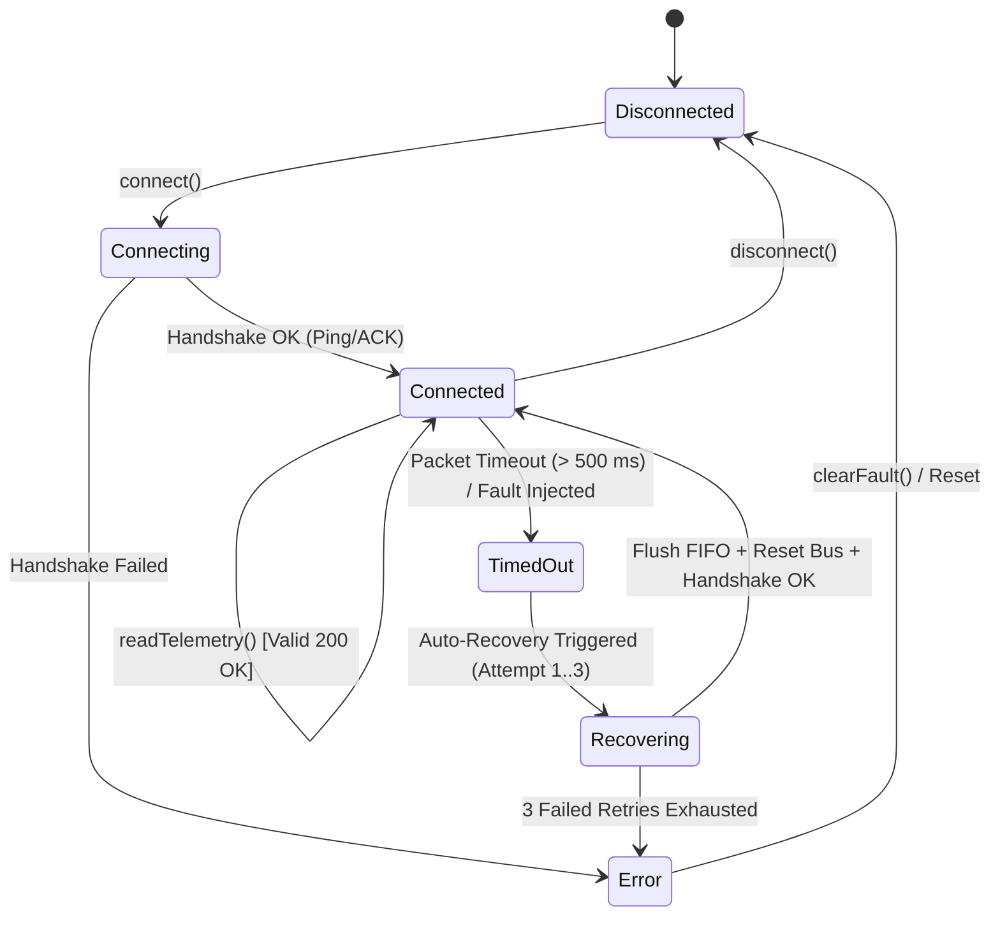

# Embedded Coprocessor Hardware Architecture & Telemetry (Task E)

## 1. System Block Diagram & Hardware Relationships (Diagram F)

The embedded coprocessor subsystem bridges the Host PC workstation to three dedicated embedded devices:

```mermaid
graph TD
    subgraph HostPC ["Host Workstation (Windows 11)"]
        UI["WorkbenchApp HardwareView"]
        DM["DeviceManager (HAL)"]
        UI --> DM
    end

    subgraph USB_Tree ["USB 2.0 Host Infrastructure"]
        HUB["Host USB 2.0 Root Hub<br/>5.0V ±5%, max 2.0A"]
        DM --> HUB
    end

    subgraph Adapters ["Physical Target Devices & Programming Adapters"]
        subgraph MCU_Dev ["Raspberry Pi Pico (MCU)"]
            RP["RP2040 Dual ARM Cortex-M0+<br/>133 MHz, 264 KB SRAM<br/>RT6150 Buck-Boost: 3.3V IO / 1.1V Core"]
        end

        subgraph FPGA_Dev ["Digilent Arty A7-35T (FPGA)"]
            ARTY["Xilinx Artix-7 XC7A35T<br/>100 MHz System Clock, 256 MB DDR3L<br/>LTC3615: 1.0V VCCINT / 3.3V VCCO / 1.8V VCCAUX"]
        end

        subgraph JTAG_Dev ["Digilent JTAG-HS2 (Debugger)"]
            HS2["High-Speed FT232H JTAG Cable<br/>30 MHz Max TCK<br/>Auto-Sensing VREF: 1.8V to 5.0V"]
        end
    end

    HUB -->|USB CDC-ACM (COM3)| RP
    HUB -->|FT2232HQ UART (COM4)| ARTY
    HUB -->|High-Speed USB 2.0| HS2

    RP -->|High-Speed SPI Bus (12 MHz)<br/>SCK, MOSI, MISO, CS# (3.3V LVCMOS)| ARTY
    HS2 -->|6-Pin JTAG Header (J1)<br/>TCK, TMS, TDI, TDO, VREF, GND| ARTY
```

---

## 2. Target Device Hardware Profiles

| Device Identifier | Target Platform | Processing Core / Architecture | Clock Frequency | Memory | Primary Role | Physical Interface |
|:---|:---|:---|:---:|:---:|:---|:---|
| `MCU-RP2040-001` | Raspberry Pi Pico | Dual ARM Cortex-M0+ (RP2040) | 133 MHz | 264 KB SRAM, 2 MB Flash | High-rate thermal sensor polling, watchdog | USB CDC-ACM (`COM3`), SPI Master |
| `FPGA-ARTY-A7-002` | Digilent Arty A7-35T | Xilinx Artix-7 (XC7A35T-1CPG236C) | 100 MHz | 256 MB DDR3L, 33,280 Logic Cells | Hardware matrix acceleration & FEA offload | FTDI FT2232HQ (`COM4`), SPI Slave |
| `JTAG-HS2-003` | Digilent JTAG-HS2 | FTDI FT232H High-Speed USB Bridge | 30 MHz (TCK) | 4 KB FIFO buffer | Bitstream flashing, TAP boundary scan, debugging | Dedicated JTAG 6-pin Header |

---

## 3. Dynamic Voltage Reference Sensing ($V_\text{REF}$)

Unlike fixed-voltage programming cables, the **Digilent JTAG-HS2** incorporates active bidirectional level translators (Texas Instruments SN74AVC4T245) controlled by the sensed reference voltage on Pin 1 (`VREF`):
- **Sense Range**: $1.8\text{ V} \le V_\text{REF} \le 5.0\text{ V}$.
- **Automatic Driver Biasing**: The cable drivers automatically match the I/O bank voltage of the target board (Artix-7 Bank 0 at $3.30\text{ V}$).
- **Power Sequencing Protection**: If $V_\text{REF} < 1.6\text{ V}$ (e.g., target unpowered or cable disconnected), the JTAG drivers enter high-impedance (Hi-Z) state, preventing parasitic reverse-biasing of unpowered FPGA silicon.

---

## 4. Hardware Lifecycle & Fault-Recovery State Machine (Diagram I)

To verify robust handling of communication dropouts, cable disconnects, and packet corruptions, the workbench implements a multi-state device lifecycle with automated 3-retry recovery:



### Fault Injection & Self-Healing Protocol
1. **Fault Trigger**: The user or automated test activates `injectFault(true)` on any connected device, simulating a transient hardware freeze or disconnected USB cable.
2. **Timeout Detection**: Subsequent calls to `readTelemetry(500)` fail to receive a response within 500 ms, transitioning status to `ConnectionStatus::TimedOut`.
3. **Recovery Sequence**:
   - Step 1: `DeviceManager` detects `TimedOut` state.
   - Step 2: Executes bus reset and flushes RX/TX buffers.
   - Step 3: Re-issues synchronization ping (`SYNC_REQ`).
   - Step 4: Restores `ConnectionStatus::Connected` and resumes 10 Hz telemetry polling.

---

## 5. Strict Simulation Disclosure

In compliance with the Zero-Fabrication rule:
- **All three adapters are simulated mock adapters** (`isSimulated = true`).
- Telemetry values (temperatures, core voltages, I/O rail voltages) are synthetically generated from physics-based mathematical models (ambient baseline plus sinusoidal thermal fluctuation and Gaussian noise).
- The desktop user interface prominently labels every device with a bright orange `[SIMULATED]` tag.
