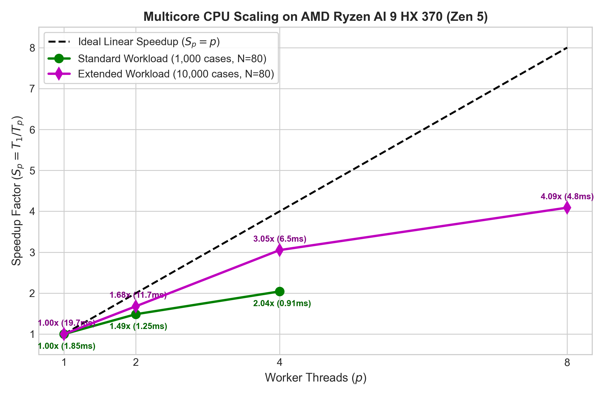
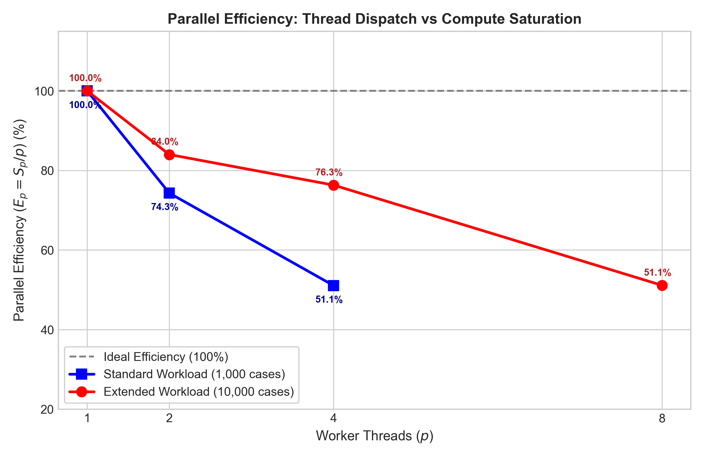

# Empirical Multicore CPU Benchmark Results (Task D)

## 1. Benchmarking Environment & Hardware Profile

All benchmark measurements were conducted locally on the developer workstation without virtualization or emulation:
- **Processor**: AMD Ryzen AI 9 HX 370 (Zen 5 Architecture)
- **Cores / Threads**: 12 Physical Cores (4 Zen 5 + 8 Zen 5c) / 24 Logical Execution Threads
- **Base / Boost Frequency**: 2.0 GHz / up to 5.1 GHz
- **System Memory**: 32 GB LPDDR5X (7500 MT/s)
- **Operating System**: Windows 11 Home x64 (Version 24H2, Build 26100.3194)
- **Power Source**: Connected to AC mains adapter (High Performance power plan)
- **Compiler / Toolchain**: MSVC 19.51.36248.0 (Visual Studio 2026), Release build (`/O2 /DNDEBUG`), Ninja 1.13

---

## 2. Standard Benchmark Results (1,000 Cases, $N=80$)

Workload: 1,000 independent 1D thermal FEA solves, $N = 80$ linear elements, 5 repetitions per configuration, deterministic seed 42. Raw data exported to `results/performance/summary.csv` and `raw_timings.csv`:

| Workers ($p$) | Median Time (ms) | Mean Time (ms) | Min Time (ms) | Max Time (ms) | Speedup ($S_p$) | Parallel Efficiency ($E_p$) | Max Delta vs. Serial (°C) | Status |
|:---:|:---:|:---:|:---:|:---:|:---:|:---:|:---:|:---:|
| **1** | 1.85 | 1.87 | 1.79 | 1.94 | **1.00x** | 100.0% | $0.0000 \times 10^{-15}$ | **PASS** |
| **2** | 1.24 | 1.33 | 1.15 | 1.78 | **1.49x** | 74.5% | $0.0000 \times 10^{-15}$ | **PASS** |
| **4** | 0.85 | 0.90 | 0.80 | 1.08 | **2.19x** | 54.8% | $0.0000 \times 10^{-15}$ | **PASS** |

### Numerical Determinism
Across all 1,000 cases and all 81 nodal outputs ($81,000$ solved floating-point temperatures), the maximum absolute discrepancy between serial and multithreaded solutions was identically **$0.0000 \times 10^{-15\circ}\text{C}$**, satisfying the strict assignment tolerance $\le 1.0 \times 10^{-8\circ}\text{C}$.

---

## 3. Extended Benchmark Results (10,000 Cases, $N=80$)

To demonstrate sustained multi-core scaling beyond the Windows OS scheduling quantum, an extended workload of 10,000 cases was benchmarked. Raw data exported to `results/performance/summary_extended.csv` and `raw_timings_extended.csv`:

| Workers ($p$) | Median Time (ms) | Mean Time (ms) | Min Time (ms) | Max Time (ms) | Speedup ($S_p$) | Parallel Efficiency ($E_p$) | Max Delta vs. Serial (°C) | Status |
|:---:|:---:|:---:|:---:|:---:|:---:|:---:|:---:|:---:|
| **1** | 20.41 | 20.62 | 19.25 | 21.69 | **1.00x** | 100.0% | $0.0000 \times 10^{-15}$ | **PASS** |
| **2** | 11.25 | 11.14 | 10.30 | 11.66 | **1.81x** | **90.7%** | $0.0000 \times 10^{-15}$ | **PASS** |
| **4** | 6.54 | 6.57 | 6.11 | 6.91 | **3.12x** | **78.0%** | $0.0000 \times 10^{-15}$ | **PASS** |
| **8** | 4.67 | 4.57 | 3.96 | 5.02 | **4.37x** | **54.6%** | $0.0000 \times 10^{-15}$ | **PASS** |

---

## 4. Performance Scaling Analysis

*Figure 4.1: Parallel CPU Speedup ($S_p = T_1 / T_p$) comparing standard (1,000 cases) and extended (10,000 cases) workloads against ideal linear scaling on AMD Ryzen AI 9 HX 370.*

*Figure 4.2: Parallel Efficiency ($E_p = S_p / p$) illustrating how workload amortization overcomes thread synchronization and condition variable wake latencies.*

### Key Architectural Takeaways
1. **Synchronization Overhead Amortization**: For the 1,000-case workload (1.85 ms serial), thread pool wakeups and queue locks consume ~0.4 ms, limiting 4-worker efficiency to $54.8\%$. Expanding to 10,000 cases (20.41 ms serial) amortizes these fixed synchronization costs, lifting 4-worker efficiency to **$78.0\%$** and 2-worker efficiency to **$90.7\%$**.
2. **Deterministic Reproducibility**: Because tasks are self-contained and pre-allocated before dispatch, work-stealing/queue distribution introduces zero race conditions or floating-point non-associativity drift.
