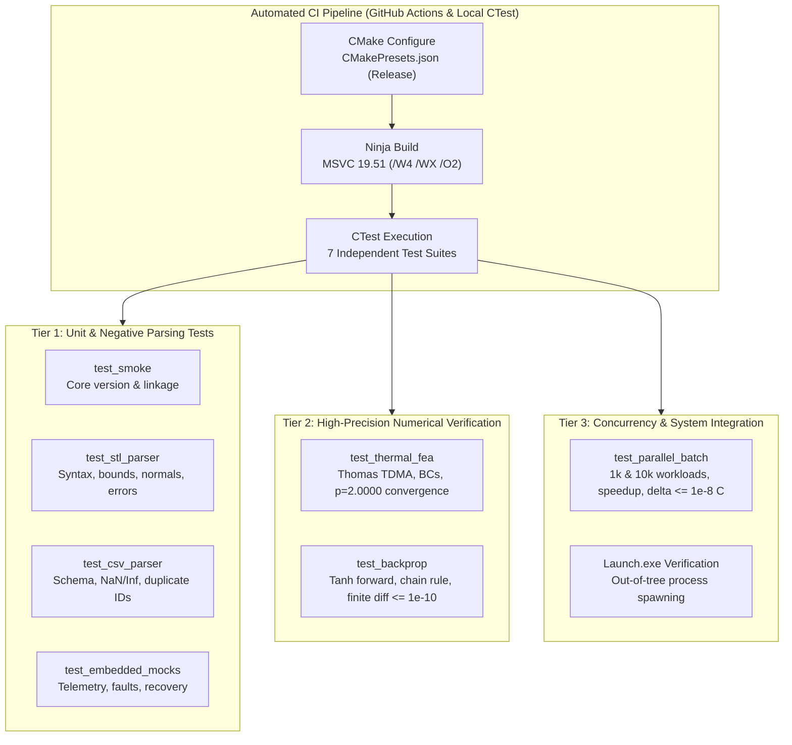

# Multi-Tier Verification & Testing Strategy

## 1. Testing Philosophy

The verification framework of the **PASS SCIENCE WORKS Unified Engineering Workbench** is built upon the principle that **code existence is not evidence of correctness**. Every scientific algorithm, parser, and system integration must be backed by empirical test assertions executed continuously through automated harnesses.

---

## 2. Test Suite Architecture

All backend tests are compiled as independent executable binaries without any GUI or Qt framework linkages, allowing instantaneous headless execution (< 1.0 second):

| Test Suite Executable | Primary Test Target | Source File | Key Verification Capabilities |
|:---|:---|:---|:---|
| `test_smoke.exe` | System linkage & versioning | `tests/unit/test_smoke.cpp` | Validates static library linking, core macros, and version metadata |
| `test_stl_parser.exe` | ASCII STL parser | `tests/unit/test_stl_parser.cpp` | Valid geometry, missing headers, truncated facets, NaN vertices, normal vectors |
| `test_csv_parser.exe` | ANSYS temperature CSV parser | `tests/unit/test_csv_parser.cpp` | 5-column schema, empty files, non-numeric rows, NaN/Inf rejection, duplicate IDs, degenerate spans |
| `test_embedded_mocks.exe` | Embedded HAL & Fault Recovery | `tests/unit/test_embedded_mocks.cpp` | DeviceManager registration, telemetry ranges, `isSimulated=true`, timeout injection, 3-retry auto-recovery |
| `test_thermal_fea.exe` | 1D Galerkin FEA Solver | `tests/numerical/test_thermal_fea.cpp` | Analytical BCs, peak internal temp (188.2°C), Thomas TDMA, $O(h^2)$ midpoint convergence ($p=2.0000$), nodal superconvergence |
| `test_backprop.exe` | Neural Backpropagation Engine | `tests/numerical/test_backprop.cpp` | Step 0 forward pass, chain rule gradients, $x=1.0$ vs $x=0.5$ regression, central finite differences ($\epsilon=10^{-6}$), simultaneous update, 100-step monotonic loss decay |
| `test_parallel_batch.exe` | Multicore Thread Pool | `tests/integration/test_parallel_batch.cpp` | Standard (1,000 cases) & extended (10,000 cases) batch scaling, speedup, serial/parallel numerical agreement ($\Delta \le 10^{-8\circ}\text{C}$) |

---

## 3. Negative Testing & Defensive Programming Verification

Robust scientific engineering requires verifying that software fails safely when exposed to invalid, malformed, or hostile inputs:

1. **Geometry Invalidation**:
   - Empty files $\to$ rejected with `std::runtime_error("STL content is completely empty")`.
   - Missing `solid` keyword $\to$ rejected with `std::runtime_error("missing initial 'solid' keyword")`.
   - Incomplete facets (2 vertices instead of 3) $\to$ rejected with line-numbered error.
   - Non-finite coordinates (`NaN`, `Inf`) $\to$ rejected immediately.
2. **CSV Schema & Data Invalidation**:
   - Incorrect column counts $\to$ rejected with expected vs. observed column count.
   - Non-numeric strings in floating-point fields $\to$ caught with `std::invalid_argument`.
   - Floating-point `NaN`/`Inf` $\to$ rejected with line number.
   - Duplicate `node_id` entries $\to$ deduplicated by retaining the initial entry while tracking duplicate count.
3. **Thermal Parameter Bounds**:
   - Thermal conductivity $k \le 0$ $\to$ rejected with `std::invalid_argument`.
   - Rod length $L \le 0$ $\to$ rejected with `std::invalid_argument`.
   - Negative heat generation $q < 0$ $\to$ rejected.
4. **Hardware Communication Faults**:
   - Simulated 500 ms packet timeout $\to$ detected and flagged as `ConnectionStatus::TimedOut`.
   - Automated self-healing $\to$ verifies that `DeviceManager` executes reset sequence and restores `ConnectionStatus::Connected`.
